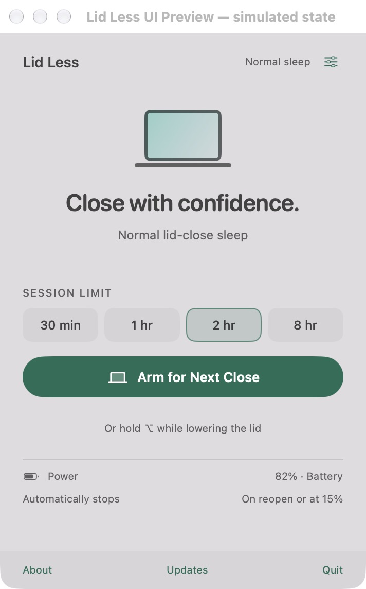
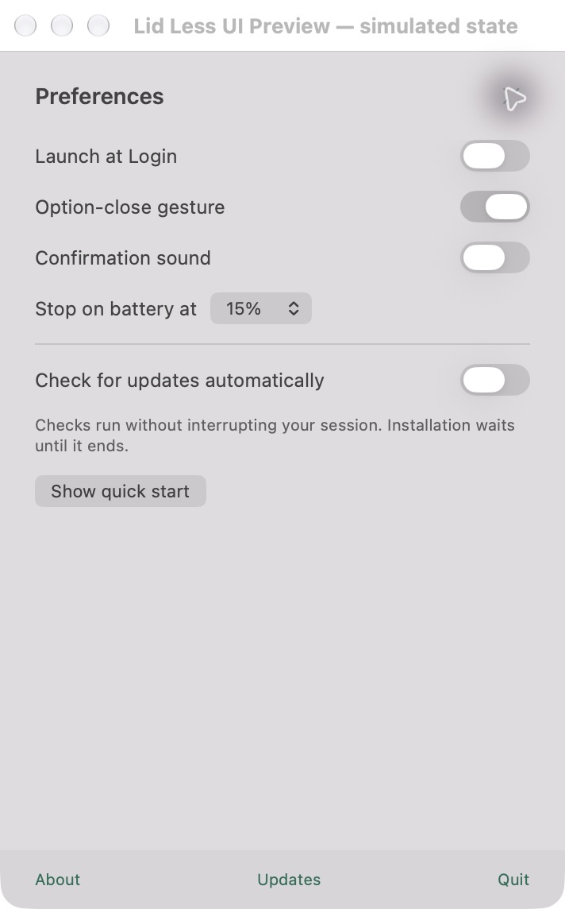

# Lid Less

Keep working with your MacBook closed. A small native menu-bar app with no `sudo`, no privileged sleep helper, and no subscription.

**[Download the latest release](https://github.com/Koodattu/lid-less/releases/latest)** · Apple Silicon · macOS 14+

 

*Native interface preview with simulated session and battery values.*

## Close with confidence

1. Unzip the download and move **Lid Less.app** to Applications.
2. Open the menu-bar icon, pick **30 min**, **1 hr**, **2 hr**, or **8 hr**, then choose **Arm for Next Close**.
3. Close within 60 seconds. On Macs with a readable lid-angle sensor, you can also hold **⌥ Option** while lowering the lid.

Reopen to end the session. **Cancel Arming**, **End Session**, and quitting restore normal lid handling. A live countdown shows the remaining time. Sessions stop at the chosen battery floor while unplugged or at critical temperature. Screen-lock settings stay unchanged.

The popover uses native macOS controls and material, a high-contrast primary action, and respects accessibility settings. Preferences include **Launch at Login**, Option-close, a confirmation sound, and a battery cutoff from 10–50% (default 15%). Startup always leaves normal sleep enabled. The default session limit remains eight hours.

## Updates

Open **Updates** in the popover and choose **Check for Updates**, or enable automatic checks in Preferences. [Sparkle](https://sparkle-project.org/) downloads updates from this repository's GitHub Releases, verifies the signed feed and archive, and handles replacement and relaunch. Checks, download progress, cancellation, and Install & Restart stay inside the popover. Checks do not block arming; downloading and installation wait until your keep-awake session ends. Canceling or finishing an update makes arming available again. Automatic checks are off by default; no system profile is sent.

**Upgrading from v0.1.x:** download this release manually once. Those versions don't contain the updater; v0.2.0 and later can update in the app.

Downloads are ad-hoc signed, **not Apple-notarized**. Sparkle's update signatures are separate from Apple notarization. If macOS blocks the initial download, follow [Apple's instructions for opening an app you trust](https://support.apple.com/en-us/102445), or build from source.

## Compatibility and recovery

Closed-lid operation has been confirmed by the maintainer on one Apple Silicon Mac. It uses an undocumented IOKit control; other hardware and OS versions still need testing. A successful power request isn't proof that a particular Mac stayed awake. Manual arming works without the lid-angle sensor.

Use a ventilated surface, not a bag. Avoid running alongside other lid-sleep utilities: the override is shared system state. If recovery fails, choose **Retry Restore Sleep**, follow the [recovery instructions](docs/technical-notes.md#recovery), or restart your Mac. **About → Copy diagnostics** creates a short report you can paste into an issue.

## Build

Requires Xcode 26+ or a compatible Swift toolchain and macOS SDK. The built app supports macOS 14+. Sparkle is the only third-party runtime dependency, pinned in `Package.resolved`.

```sh
git clone https://github.com/Koodattu/lid-less.git
cd lid-less
bash scripts/build-app.sh
open ".build/Lid Less.app"
```

Run `swift test` for lifecycle, preferences, and update-gating tests. `bash scripts/package-release.sh` creates an app ZIP and SHA-256 checksum. See [release signing and update tests](docs/releasing.md) before publishing a new version.

[Technical notes and hardware checklist](docs/technical-notes.md) · [Apache 2.0 license](LICENSE)

Inspired by [Clamshell](https://clamshell.dev/). Independently implemented using Apple's IOKit APIs. Sparkle is distributed under its [MIT license](https://github.com/sparkle-project/Sparkle/blob/2.x/LICENSE), included in the app.
